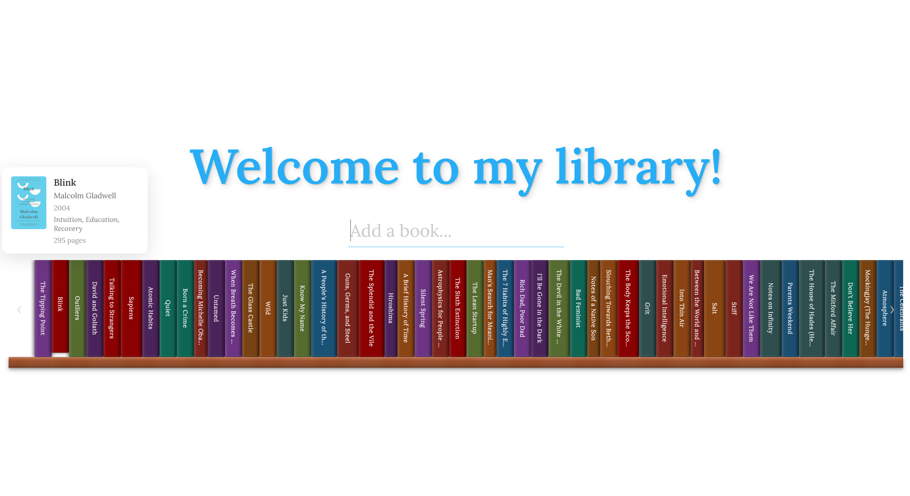

# Virtual Library



A virtual bookshelf that catalogs every book I've read. The books sit as spines on a scrollable shelf carousel. Hover over a spine to see the cover, author, genre, and page count!

## Why this exists

Reading is one of the most reliable ways to build knowledge, and the more you know, the more analytically you're able to think. You have more to connect new ideas to, more perspectives to reason from, and more patterns to recognize. This project is a way to keep a visible, browsable record of that reading, rather than letting a finished book disappear into a list.

## Features

- Single scrollable shelf carousel of every book you've read
- Search-and-add books via the [Open Library](https://openlibrary.org/) API
- Books persist in the browser (`localStorage`), seeded from a one-time Goodreads CSV import
- Hover popups with cover art and book details

## Tech stack

- **[React 19](https://react.dev/)** + **[TypeScript](https://www.typescriptlang.org/)** for the UI
- **[Vite](https://vite.dev/)** for the dev server and build
- **[Open Library API](https://openlibrary.org/developers/api)** for book search, metadata, and cover art
- **Plain CSS** (no framework) with [Lora](https://fonts.google.com/specimen/Lora) from Google Fonts
- **Browser `localStorage`** for persistence — no backend or database
- **[oxlint](https://oxc.rs/)** for linting
- **[Vitest](https://vitest.dev/)** + **[React Testing Library](https://testing-library.com/docs/react-testing-library/intro/)** (with jsdom) for tests
- A standalone **Node.js script** (`scripts/import-goodreads.mjs`) for one-time CSV import, decoupled from the app itself

## Running it locally

Requires [Node.js](https://nodejs.org/) (includes npm).

```bash
npm install
npm run dev
```

Then open the local URL Vite prints (usually `http://localhost:5173`).

Other commands:

```bash
npm test            # run the test suite once
npm run test:watch  # re-run tests as files change
npm run build       # production build
npm run preview     # serve the production build locally
npm run lint        # run oxlint
```

## Importing your Goodreads library

The shelf is seeded from `src/data/books.json`, which is generated from a Goodreads export.

1. On Goodreads, go to **My Books**, then **Import and export** (under Tools on the left), and click **Export Library**. Download the CSV once it's ready.
2. Run the import script with the path to that file:

   ```bash
   node scripts/import-goodreads.mjs path/to/goodreads_library_export.csv
   ```

The script keeps only books on your **read** shelf and overwrites `src/data/books.json`. Covers come from Open Library, looked up by ISBN.

The seed is only loaded the first time the app runs in a given browser. After that, the shelf is read from `localStorage`, so re-importing won't change a browser that has already loaded the app. To pick up a new import there, clear the site's `localStorage` (keys starting with `goodreads-library-`) and reload. This also discards any books you added through search.

## Tests

Tests live next to the code they test, as `*.test.ts` and `*.test.tsx`. They cover the storage service, the Open Library search mapping, spine sizing and the hover tooltip, and adding books (including duplicate handling).
